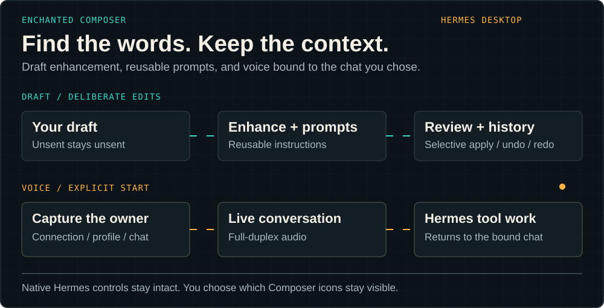
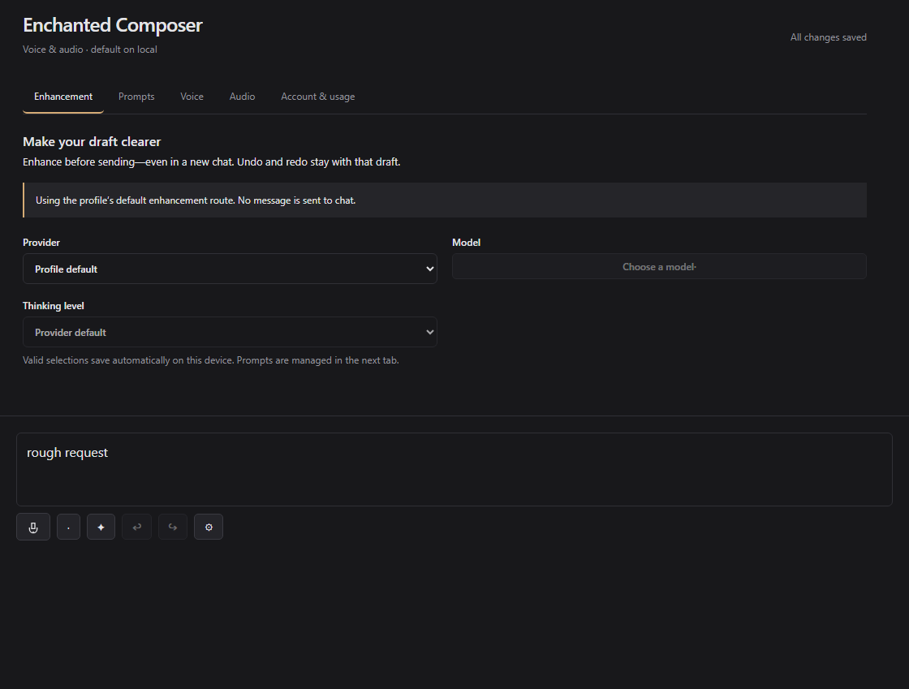
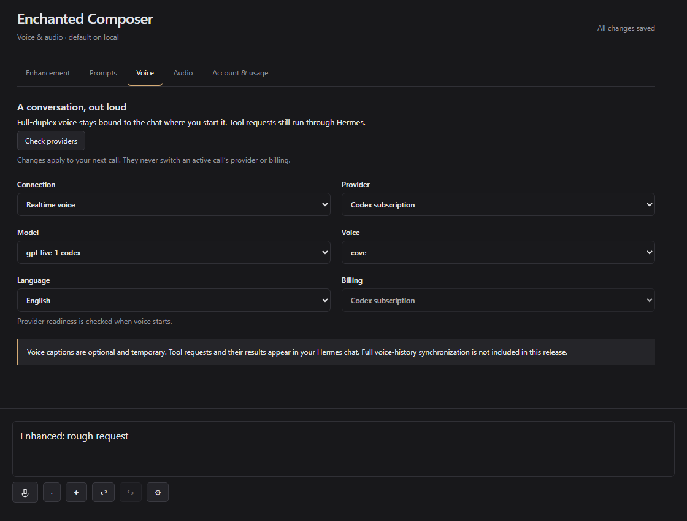
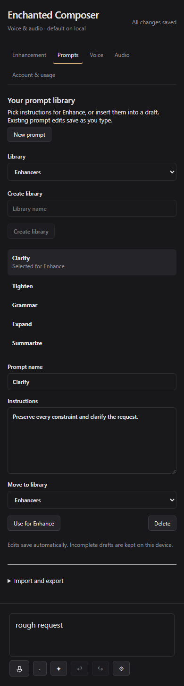

<p align="center">
  
</p>

<p align="center">
  <strong>Find the words. Keep the context.</strong><br>
  Draft enhancement, reusable prompt libraries, selective review, dependable history, and owner-bound live voice for Hermes Desktop.
</p>

<p align="center">
  <a href="https://github.com/noxius-studium/enchanted-composer/actions/workflows/ci.yml"></a>
  <a href="https://github.com/noxius-studium/enchanted-composer/actions/workflows/release.yml"></a>
  <a href="LICENSE"></a>
  
  
</p>

<p align="center">
  <a href="#install">Install</a> ·
  <a href="#what-you-get">Features</a> ·
  <a href="docs/architecture.md">Architecture</a> ·
  <a href="docs/privacy-and-security.md">Privacy &amp; security</a> ·
  <a href="docs/limitations.md">Limitations</a> ·
  <a href="https://github.com/noxius-studium/enchanted-composer/releases">Releases</a>
</p>

---

## The composer, upgraded—not replaced

Enchanted Composer extends the message composer while leaving Hermes's native **send, model, dictation, and voice controls** intact. Draft work stays local until you explicitly apply or send it. Voice captures the connection, profile, and chat selected when the call starts, so delegated tool work returns to the right conversation.

| Work with drafts | Talk in context | Keep control |
| :-- | :-- | :-- |
| Enhance unsent text without creating a chat turn | Start full-duplex voice explicitly | Show only the composer icons you want |
| Reuse prompt libraries and insert instructions | Bind voice to the selected owner and chat | Keep provider, billing, and device choices visible |
| Review selected changes before applying them | Delegate tool work back through Hermes | Retain pending settings after a failed save |
| Undo and redo without another model call | Mute, interrupt, retry, or end the call | Keep temporary captions out of durable history |

## What you get

### 01 / Deliberate draft enhancement

Enhance the current draft immediately or ask for a proposal first. Review mode keeps the original and proposed text side by side, groups bounded changes, and lets you apply selected groups or the complete proposal. Manual edits and owner changes fail closed instead of being overwritten.

### 02 / Prompt libraries that belong to you

Create libraries, edit reusable prompts, mark favorites, search by name, body, library, or tag, and insert instructions without activating them. Import is previewed before replacement; export gives you a portable JSON backup.

### 03 / History that survives real editing

Undo and redo support up to 30 owner-scoped revisions. Redo reapplies the stored result—it does not spend another model call. History survives editor remounts for saved chats and refuses to cross chat or draft boundaries.

### 04 / Owner-bound live voice

Voice starts only when requested, captures the active connection/profile/chat, and obtains its own microphone lease. Recoverable transport warnings do not kill the call; terminal failures retain bounded diagnostics and offer an explicit same-chat retry.

> Muting or push-to-talk can reduce transmitted microphone audio, but only ending the remote voice session stops further provider usage. The UI labels that boundary honestly.

### 05 / A composer bar you can simplify

Open **Enchanted Composer → Composer bar** and independently show or hide:

- Live voice and voice mode
- Prompt library and Draft Shelf
- Review and instant enhancement
- Undo and redo
- The Composer settings shortcut

The settings page remains available from the sidebar even if every composer icon is hidden.

## Interface

<table>
  <tr>
    <td width="50%"></td>
    <td width="50%"></td>
  </tr>
  <tr>
    <td align="center"><strong>Enhancement</strong><br>Choose the route, model, and thinking level.</td>
    <td align="center"><strong>Voice</strong><br>Choose the provider, model, voice, language, and billing lane.</td>
  </tr>
</table>

<details>
<summary><strong>Prompt library on a narrow window</strong></summary>
<br>
<p align="center"></p>
</details>

## Install

### From a release

1. Download the versioned ZIP and `SHA256SUMS` from [Releases](https://github.com/noxius-studium/enchanted-composer/releases).
2. Verify the archive checksum before installation.
3. Install the unified archive through Hermes Plugins.
4. Enable both the backend plugin and its Desktop half.
5. Reload Desktop plugins; use the normal backend lifecycle when backend files change.

See the complete [installation guide](docs/installation.md), including Codex subscription voice and custom bridge setup.

### Build locally

```bash
uv sync --locked --extra test
uv run python scripts/build_desktop.py
uv run python scripts/build_dashboard.py
uv run python scripts/build_desktop.py --check
uv run python scripts/build_dashboard.py --check
node --test tests/desktop/*.test.mjs tests/dashboard/*.test.mjs
uv run python -m pytest -q
uv run python -m ruff check dashboard tests scripts
node scripts/verify_desktop.mjs desktop/plugin.js
uv run python scripts/package.py
hermes plugins validate . --json
```

The deterministic package is written to `dist/enchanted-composer-<version>.zip` unless `--output` is supplied.

## Verifiable releases

The current manifest version is **0.2.7**. Release automation keeps this value synchronized across every package and documentation source.

The **CI** workflow runs automatically whenever a pull request is merged into `main`. Only a successful completed CI run unlocks the automatic **Release package** workflow for that exact `main` commit; a failed CI run cannot publish, and an older successful run is ignored if a newer merge has superseded it. The release workflow then:

1. re-runs the complete verification suite,
2. uses an explicit new manifest version when the merged PR provides one, or increments the patch version automatically,
3. commits the synchronized version update to `main` when needed,
4. creates the matching `v<version>` tag, and
5. publishes the verified GitHub Release assets.

The release workflow can also be started manually for the latest `main` commit. Serialized concurrency prevents two nearby merges from racing over a version or tag.

Every release produces:

```text
enchanted-composer-<version>-<12-character-commit>.zip
SHA256SUMS
RELEASE-METADATA.json
```

`RELEASE-METADATA.json` records the plugin version, full commit SHA, short commit SHA, archive name, and SHA-256 checksum. The workflow verifies `SHA256SUMS` before uploading anything, confirms the tag points at the exact verified commit, and publishes the same files as GitHub Release assets.

### Official Hermes catalog updates

Catalog promotion is intentionally separate from release automation. Run the **Propose Hermes catalog update** action manually and optionally choose a published release tag; a blank tag selects the latest stable release. The action updates the exact SHA pin, version, README, banner, and screenshot references on the `Deadtrix21/hermes-agent` fork, then opens or refreshes a pull request against `NousResearch/hermes-agent`.

The action requires a repository Actions secret named `HERMES_CATALOG_TOKEN` with permission to push to the `Deadtrix21/hermes-agent` fork and open public pull requests. It cannot publish directly: Hermes catalog CI and Nous maintainer review remain mandatory, and the official plugin documentation updates only after that PR is merged.

## Boundaries that stay visible

- **No telemetry or self-update:** catalog updates happen through reviewed commit-SHA changes.
- **No silent provider fallback:** provider, model, voice, and billing combinations are validated as one tuple.
- **Credentials stay backend-side:** Codex owns its login; API and bridge secrets remain in the active Hermes profile scope.
- **Microphone access is explicit:** requested only for device discovery or a started call, then released during cleanup.
- **Ordinary voice turns are temporary:** full two-sided voice-history synchronization is not claimed. Delegated tool requests and results remain in the bound Hermes chat.
- **Live acceptance is still live acceptance:** passing mocks and isolated tests do not prove a paid provider call or a specific microphone works on your machine.

Read the full [privacy and security disclosure](docs/privacy-and-security.md) and [current limitations](docs/limitations.md).

## Project map

| Path | Purpose |
| :-- | :-- |
| `desktop/` | Composer controls, settings, draft/history logic, and voice client |
| `dashboard/` | Owner-scoped API, provider discovery, voice transport, and activity records |
| `tests/` | Contract, persistence, UI, race-condition, and packaging coverage |
| `scripts/` | Deterministic builds, verification, and release packaging |
| `docs/` | Architecture, installation, migration, privacy, and limitations |

## Documentation

[`Installation`](docs/installation.md) · [`Architecture`](docs/architecture.md) · [`Migration`](docs/migration.md) · [`Privacy & security`](docs/privacy-and-security.md) · [`Limitations`](docs/limitations.md) · [`Security policy`](SECURITY.md)

## License and provenance

Enchanted Composer is MIT licensed. It is derived in concepts, flows, and behavior from the MIT-licensed projects documented in [PROVENANCE.md](PROVENANCE.md), with preserved notices in [NOTICE.md](NOTICE.md). The implementation in this repository is substantially rewritten.

Maintained by the [`noxius-studium`](https://github.com/noxius-studium) organization and submitted to the Hermes catalog by [@Deadtrix21](https://github.com/Deadtrix21).

---

<p align="center"><strong>Build it. Break the assumption. Write down what survived.</strong></p>
